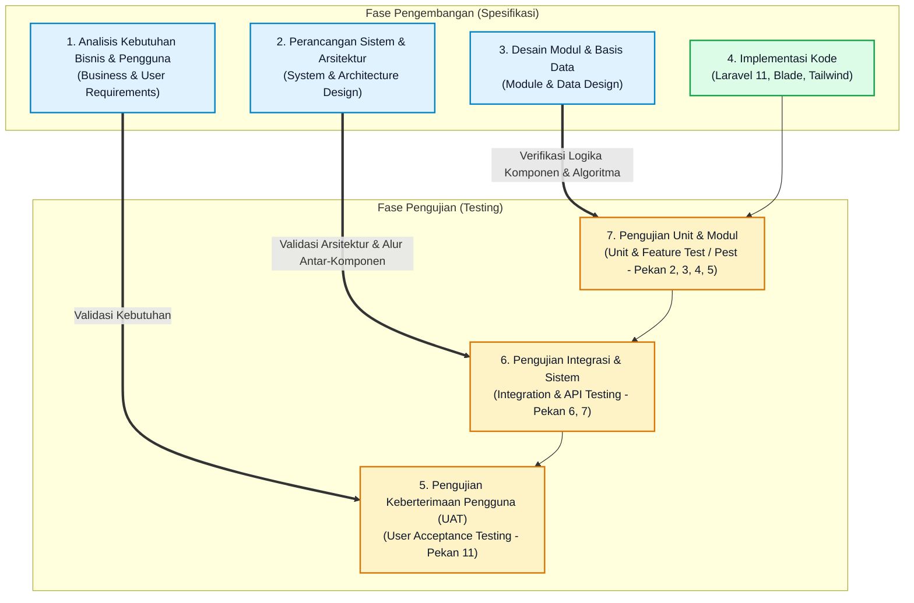

# Dokumen Penjaminan Mutu Perangkat Lunak (SQA) - Pekan 1
## Pemetaan V-Model & Verifikasi vs Validasi (ISO/IEC/IEEE 29119)
**Proyek:** SiBatik ERP (Sistem Informasi ERP/EIS untuk UMKM Batik Pamekasan)  
**Mata Kuliah:** Manajemen dan Proyek SI (MKB020204)  
**Institusi:** Universitas Islam Madura  
**Acuan Standar:** ISO/IEC/IEEE 29119 Software Testing Standards & SQA Framework

---

## 1. Pendahuluan

SiBatik ERP adalah sistem terpadu Enterprise Resource Planning (ERP) dan Executive Information System (EIS) yang dikembangkan khusus untuk UMKM Batik di Pamekasan, Madura. Sistem ini mengadopsi proses bisnis operasional dan akuntansi dari praktik terbaik industri batik (merujuk pada studi kasus Toko Batik Rumah Merah Lasem oleh Sulistiono, Hediyanto, & Budiyono, 2026), mencakup modul Pengadaan (*Purchase*), Persediaan (*Inventory*), Penjualan (*Sales*), Kasir (*Point of Sale/POS*), Faktur (*Invoicing*), dan Dashboard Eksekutif (*EIS*).

Dalam kerangka mata kuliah *Manajemen dan Proyek SI*, fokus utama pengembangan tidak semata-mata implementasi fitur (*feature delivery*), melainkan **penjaminan mutu perangkat lunak (*Software Quality Assurance / SQA*)** melalui pendekatan siklus hidup pengujian terstruktur.

---

## 2. Pemetaan V-Model Pengembangan SiBatik ERP

Model V (*V-Model*) menggambarkan hubungan simetris antara setiap fase pengembangan (sisi kiri - dekomposisi dan spesifikasi kebutuhan) dengan fase pengujian yang bersesuaian (sisi kanan - integrasi dan pengujian).

### 2.1 Rincian Pemetaan Tingkat V-Model

| Tingkat V-Model | Dokumen Spesifikasi Input | Aktivitas Pengujian | Kriteria Keberhasilan (Exit Criteria) | Pelaksanaan |
| :--- | :--- | :--- | :--- | :--- |
| **Kebutuhan Bisnis $\leftrightarrow$ UAT** | Dokumen Kebutuhan Bisnis (SOP UMKM Batik, Modul Odoo Rumah Merah Lasem) | **User Acceptance Testing (UAT):** Pengujian skenario end-to-end oleh perwakilan peran pengguna (Admin, Kasir, Bagian Pembelian, Bagian Gudang, Bagian Penjualan, Keuangan, Manajer Eksekutif). | Seluruh skenario uji bisnis (RFQ hingga Bayar, SO hingga Delivery, POS) disetujui dengan skor kepuasan minimal 4.0/5.0 dan tanpa cacat berstatus *High/Critical*. | **Pekan 11** |
| **Desain Sistem & Arsitektur $\leftrightarrow$ Pengujian Sistem & Integrasi** | Dokumen Desain Arsitektur (REST API, Relasi Modul, Alur Data State Transition) | **Integration & API Testing:** Pengujian integrasi antar-modul (PO $\rightarrow$ Goods Receipt $\rightarrow$ Stock Move $\rightarrow$ Vendor Bill; SO $\rightarrow$ Delivery Order $\rightarrow$ Customer Invoice) serta pengujian endpoint REST API dengan Newman/Postman. | Respon HTTP sesuai spesifikasi (200, 201, 401, 403, 422), konsistensi transaksional atomik database (ACID), dan tidak terjadi *race condition* stok. | **Pekan 6 & 7** |
| **Desain Modul & Algoritma $\leftrightarrow$ Pengujian Unit & Komponen** | Desain Logika Bisnis (`app/Services`: `PricingService`, `HppService`, `ReorderService`, `KpiService`) | **Unit & Feature Testing (Pest):** Pengujian logika diskon, perhitungan HPP, batas minimum stok (BVA/EP, Decision Table, White-box coverage). | 100% test case lulus, Branch Coverage $\ge 80\%$ pada folder `app/Services`, tanpa regresi. | **Pekan 2, 3, 4, 5** |

---

## 3. Konsep Verifikasi vs Validasi dalam Proyek SiBatik ERP

Sesuai standar **ISO/IEC/IEEE 29119-1 (Concepts and Definitions)**:

```mermaid
flowchart LR
    subgraph Verification ["VERIFIKASI ('Are we building the product right?')"]
        V1["Pemeriksaan statis kode (linting, static analysis)"]
        V2["Form Request validation (aturan tipe data, format SKU, batas)"]
        V3["Unit test Service logic (Pest: HPP, Diskon, Formula)"]
        V4["Code Review & PCOV Branch Coverage >= 80%"]
    end

    subgraph Validation ["VALIDASI ('Are we building the right product?')"]
        VAL1["UAT Berbasis Skenario Kasir & Bagian Gudang"]
        VAL2["Validasi Alur Bisnis Odoo Lasem: Goods Receipt dari PO"]
        VAL3["Validasi Delivery Order Otomatis saat SO Dikonfirmasi"]
        VAL4["Dashboard EIS menyajikan KPI riil bagi pemilik UMKM Batik"]
    end

    Verification -.->|"Menjamin kepatuhan teknis & bebas cacat"| Validation
```

### 3.1 Verifikasi (*Verification*)
- **Pertanyaan Inti:** *"Apakah kita membangun produk dengan benar?" (Are we building the product right?)*
- **Definisi:** Evaluasi terhadap artefak perangkat lunak pada setiap fase pengembangan untuk memastikan kepatuhan terhadap standar teknis, konvensi kode, batasan sintaksis, dan spesifikasi arsitektur yang telah ditentukan.
- **Penerapan pada SiBatik ERP:**
  1. **Pengujian Unit Otomatis (Pest):** Memverifikasi bahwa fungsi kalkulasi diskon di `PricingService` menghasilkan angka matematis yang tepat untuk tiap kombinasi input.
  2. **Validasi Form Request Laravel:** Memverifikasi bahwa data masukan pengguna memenuhi konstrain (misal: kuantitas harus integer $1 \le qty \le 9999$, nomor faktur unik).
  3. **White-Box Testing & Branch Coverage (PCOV):** Memverifikasi seluruh jalur eksekusi kode (*Control Flow Graph*) dalam `app/Services` dieksekusi oleh minimal satu skenario uji.
  4. **Pemeriksaan Arsitektur:** Memastikan tidak ada logika bisnis di dalam Controller, tidak ada *raw SQL query* langsung dari input pengguna, dan setiap transaksi termutasi secara aman.

### 3.2 Validasi (*Validation*)
- **Pertanyaan Inti:** *"Apakah kita membangun produk yang benar?" (Are we building the right product?)*
- **Definisi:** Evaluasi terhadap perangkat lunak yang telah terintegrasi di akhir siklus untuk memastikan bahwa produk benar-benar memenuhi kebutuhan nyata pengguna, mengatasi masalah operasional UMKM Batik Pamekasan, dan sesuai dengan skenario bisnis rujukan.
- **Penerapan pada SiBatik ERP:**
  1. **Skenario Operasional Nyata Toko Batik:** Memvalidasi bahwa alur pembelian kain dan pewarna dari vendor benar-benar menghasilkan Goods Receipt yang menambah stok gudang secara otomatis.
  2. **Pengujian POS Kasir Batik:** Memvalidasi bahwa kasir dapat melayani pembelian batik cap dan batik tulis dengan diskon reseller, mencetak struk, dan mengurangi stok fisik secara *real-time*.
  3. **Penyelarasan dengan Temuan Sulistiono et al. (2026):** Memvalidasi bahwa masalah duplikasi data vendor/pelanggan dan ketidakjelasan notifikasi kesalahan yang dialami pada sistem rujukan berhasil diselesaikan di SiBatik ERP dengan *flash messages* dan *inline feedback*.
  4. **User Acceptance Testing (UAT):** Pengujian langsung oleh calon pengguna akhir berdasarkan lembar kerja skenario uji dan kuesioner skala Likert (1–5).

---

## 4. Matriks Ketertelusuran Mutu (Traceability Matrix) Tahap Awal

| ID Kebutuhan | Deskripsi Kebutuhan Bisnis | Komponen Desain Teknis | Metode Pengujian | Level V-Model |
| :--- | :--- | :--- | :--- | :--- |
| **REQ-AUTH-01** | Pengguna dapat masuk ke sistem sesuai hak akses role masing-masing (7 role) | Laravel Breeze + Spatie Permission, `RoleMiddleware` | Smoke Test & Role Redirect Feature Test | Unit / Komponen (Pekan 1) |
| **REQ-MST-01** | Master produk mendukung varian ukuran (S-XL) dan motif batik khas Pamekasan | Migration `products`, `product_variants`, Unique SKU Index | Feature Test CRUD & Deteksi Duplikasi | Unit & Integrasi (Pekan 2) |
| **REQ-PUR-01** | Transisi status PO terikat hak akses persetujuan | State Machine PO (`rfq` $\rightarrow$ `menunggu_persetujuan` $\rightarrow$ `disetujui`) | State Transition Testing (Pest Dataset) | Komponen & Integrasi (Pekan 4) |
| **REQ-INV-01** | Penerimaan barang (Goods Receipt) memicu penambahan mutasi stok | `StockMove` Service & Transaction Observer | Integration Test PO $\rightarrow$ GR $\rightarrow$ Stock | Integrasi Sistem (Pekan 6) |
| **REQ-POS-01** | Kasir dapat membuka sesi kasir, scan varian, input diskon baris, dan cetak invoice | Modul POS (Alpine.js + Livewire/Blade + API) | End-to-End Test (Playwright) | Sistem & UAT (Pekan 7 & 11) |
| **REQ-EIS-01** | Dashboard eksekutif menampilkan omzet, laba kotor, dan peringatan stok kritis | `KpiService` + Chart.js + Caching | Load Test (k6) & UAT Eksekutif | Sistem & UAT (Pekan 9 & 11) |

---

## 5. Kesimpulan Penjaminan Mutu Pekan 1

Pada Pekan 1, fondasi arsitektur telah disiapkan sesuai prinsip V-Model:
1. **Dasar Otentikasi dan Autorisasi Berbasis Peran:** Struktur 7 role telah dipetakan untuk menjamin kepatuhan hak akses sejak tingkat paling awal.
2. **Kesiapan Pengujian Terotomatisasi:** Framework pengujian Pest telah dipersiapkan agar setiap penambahan baris kode pada pekan berikutnya selalu disertai tes otomatis (*test-first mindset*).
3. **Pemisahan Lingkungan Melalui Kontainer:** Docker Compose menjamin pengujian dijalankan pada lingkungan yang identik (*reproducible environment*) antara mesin lokal pengembang dan server produksi kelak.
